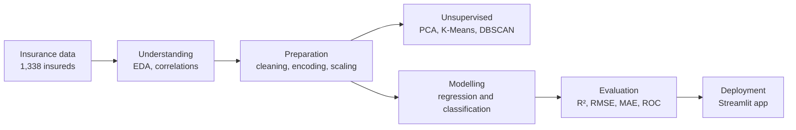

# Medical Charges Predictor


**Fifteen machine learning models compared to predict health insurance charges, with the best regressors deployed in an interactive Streamlit app.**

*Machine learning project, 2025.*

> The full analysis is in the **[notebook](https://rouaslama1.github.io/medical-charges-predictor/notebook.html)** (also in [`docs/`](docs/notebook.html)). The app interface and the notebook are in French.

## The question

What should a health insurance policy cost for a given profile, and which factors drive that cost? The dataset describes 1,338 insured people in the US (age, sex, BMI, number of children, smoker status, region) and the annual charges billed to each. The project follows the CRISP-DM process, from business understanding to deployment, so every modelling choice can be traced back to a step.

## What it does

- **Explore the data.** Distributions, correlations, and the effect of smoking, BMI and age on charges. Smokers pay about 3.8 times more on average.
- **Prepare it carefully.** Duplicate removal, outlier handling with the IQR method on log(charges), BMI capping, categorical encoding and Z-score scaling.
- **Look for structure.** PCA, then K-Means against DBSCAN to segment insureds. K-Means (k = 4) wins; DBSCAN finds no coherent density-based structure.
- **Predict charges.** Linear and polynomial regression, SVR, decision trees, Random Forest and XGBoost, tuned with GridSearchCV and RandomizedSearchCV. Overfitting is checked on every model by comparing train and test scores.
- **Classify smokers.** SVM, decision tree, Random Forest and XGBoost, evaluated with accuracy, confusion matrix and ROC curve.
- **Deploy.** A Streamlit app where you enter a profile and get an instant estimate, compared across models, with data exploration and live model performance pages.

## Results

Regression on a held-out test set (target: annual charges in $):

| Model | R² | RMSE ($) |
|---|---|---|
| Decision tree (max depth 5) | **0.900** | **4,283** |
| Random Forest | 0.894 | 4,405 |
| XGBoost (GridSearchCV) | 0.894 | 4,423 |
| XGBoost (RandomizedSearchCV) | 0.890 | 4,502 |
| SVR (tuned) | 0.886 | 4,586 |
| Polynomial regression (degree 2) | 0.866 | 4,966 |
| Linear regression | 0.719 | 7,189 |

Limiting the depth of the tree is what makes it the best model: left unconstrained it memorises the training set (train R² of 1.00, test R² of 0.79). For smoker classification, XGBoost reaches 97.8% test accuracy with an AUC of 0.996.

## Workflow



## Repository structure

```
medical-charges-predictor/
├── README.md
└── docs/
    ├── demo.gif         # app walkthrough
    └── notebook.html    # full analysis, exported from Jupyter
```

## Stack

Python · pandas · NumPy · scikit-learn · XGBoost · seaborn · matplotlib · Streamlit

## Contact

Roua Slama, Computer Science Engineering student at ESPRIT (BI & ERP), looking for a PFE in 2027.
[LinkedIn](https://linkedin.com/in/roua-slama) · [Portfolio](https://roua-slama-portfolio.netlify.app/) · slamaroua10@gmail.com
